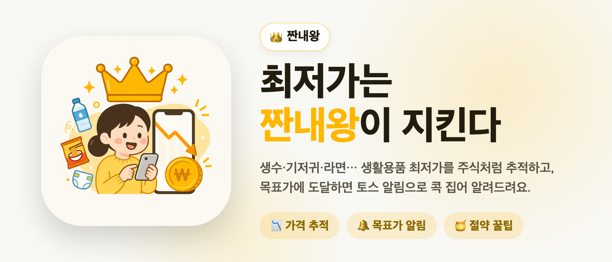

# 짠내왕 — 생활용품 최저가 추적·절약 커뮤니티 (토스 앱인토스 미니앱)

생수·기저귀·라면 같은 생활용품의 가격을 추적해 목표가에 도달하면 토스 푸시로 알려주고,
특가 제보·절약 꿀팁·절약 기록을 공유하는 토스 앱인토스(Apps in Toss) 미니앱입니다.




> **상태:** 앱인토스 출시를 목표로 프론트(.ait 번들)와 백엔드(API·크론)를 구현했습니다.
> 앱인토스 콘솔에서 발급받는 값(광고그룹 ID, 파트너 OAuth·푸시 키 등)은 저장소에 없으며, 이 값이 없으면 로그인·광고·결제·푸시는 sandbox/mock 으로 동작합니다.

---

## 무엇을 해결하나

- **"지금 사도 되나?"** — 네이버 쇼핑 API 로 상품 최저가를 주기적으로 수집해 가격 이력을 쌓고, 현재가가 역대 가격 중 어디쯤인지(백분위)·추세·평균 대비를 보여줍니다.
- **"내려가면 알려줘"** — 추적 상품에 목표가를 걸면 도달 시 토스 Smart Messaging 푸시를 보냅니다(알림 동의 사용자만, 24시간 재알림 쿨다운).
- **"계속 들어올 이유"** — 특가 제보·꿀팁 게시판, 절약 기록과 또래 비교, 출석 연속 보상, 레벨별 혜택(추적 슬롯 확장·광고 감소)으로 리텐션 루프를 만들었습니다.

## 아키텍처

앱인토스는 정적 프론트 번들(`.ait`)을 토스 CDN 에서 WebView 로 서빙하고, 백엔드는 파트너가 따로 호스팅하는 구조라 두 부분으로 나눴습니다.

```
토스 앱 WebView
  └─ ait/  (Vite + React 18 SPA → `ait build` 로 .ait 번들)
       @apps-in-toss/web-framework: appLogin · 광고(배너/전면/보상형) · IAP · 알림 동의 · 공유 · 햅틱
       SWR 로 백엔드 호출, 토스 런타임이 아니면 mock 으로 폴백
            │  Authorization: Bearer <세션 토큰>
            ▼
src/app/api/*  (Next.js 14 Route Handlers, Vercel)
  ├─ auth/toss        토스 인가 코드 교환 → HMAC 서명 세션 토큰 발급
  ├─ search, products/resolve, product/[id]   네이버 쇼핑 검색 · 상품 영속화 · 가격 분석
  ├─ tracking, savings, feed, tips, ranking, me/*   추적 · 절약 기록 · 커뮤니티 · 랭킹 · 미션
  ├─ iap-webhook      주문 상태 확인 후 권한 부여(멱등)
  └─ cron/daily       하루 1회 오케스트레이터 → fetch-prices → check-alerts → hot-tips → daily-report
            │
            ├─ Supabase Postgres (supabase/migrations/001~008)
            ├─ Upstash Redis (집계 캐시 · 레이트리밋)
            └─ 토스 파트너 API (OAuth · Smart Messaging · 주문 조회)
```

## 기술적으로 집중한 문제

### 1. 토스 WebView 안의 SPA 와 외부 백엔드 사이의 인증
- **문제**: `.ait` 번들은 토스 CDN 출처에서 열리고 백엔드는 Vercel 에 있어 쿠키 세션을 쓰기 어렵고, WebView 출처도 환경마다 달라 CORS 가 자주 막혔습니다.
- **해결**: 앱 진입 시 `appLogin()` 인가 코드를 백엔드에서 토스 OAuth 로 교환하고, 사용자 ID 를 담은 **HMAC-SHA256 서명 세션 토큰**(만료 포함, `timingSafeEqual` 비교)을 발급해 Bearer 헤더로만 인증합니다(`src/lib/auth.ts`).
  쿠키를 쓰지 않으므로 CORS 는 요청 출처를 반사하도록 미들웨어 한 곳에서 처리했습니다(`src/lib/cors.ts`, `src/middleware.ts`).
  별도 로그인 화면 없이 재방문자는 자동 인증되며, 파트너 키가 없는 개발 환경에서는 결정적인 sandbox 사용자로 폴백합니다.

### 2. 실데이터 기반 가격 이력과 "정직한" 가격 분석
- 검색 결과를 `products/resolve` 에서 네이버 상품 ID 기준으로 멱등 저장하고(동시 삽입 경합 시 재조회), 첫 가격점을 기록해 상세·추적·차트가 처음부터 실데이터로 동작하게 했습니다.
- 크론이 인기 상품과 추적 상품을 나눠 재조회해 `price_history` 에 누적합니다.
- 분석(`src/lib/price-analyzer.ts`)은 가격 이력의 백분위·추세·최적 구매월을 계산하는 통계이므로, 초기에 붙어 있던 "AI" 표기를 "가격 분석"으로 바꿨습니다.
- 추적 시작 시점 가격을 기준가로 저장해, 이후 하락분을 자동으로 "절약액"으로 보여줍니다.

### 3. 사용자가 늘어도 DB 가 버티도록
- 같은 상품을 하루에 여러 번 열어도 6시간 안에 기록된 가격점이 있으면 `price_history` 를 다시 쓰지 않습니다.
- 랭킹·또래 비교처럼 월 전체를 집계하는 조회는 Redis 에 60초 cache-aside 로 두고, Redis 장애 시 DB 로 폴백합니다(`src/lib/upstash.ts`).
- 알림 크론은 동의·쿨다운 조건을 쿼리에서 거르고 한 번에 최대 500건만 처리해 추적 테이블 전체를 메모리에 올리지 않습니다.
- Vercel Hobby 플랜의 크론 1개 제한에 맞춰, 하루 한 번 도는 오케스트레이터가 하위 작업을 순서대로 호출합니다(`src/app/api/cron/daily`).

### 4. 수익화와 권한 처리의 신뢰성
- 인앱 결제 권한은 요청 본문이 아닌 **세션의 사용자 ID** 로만 부여하고, 운영 환경에서는 토스 주문 상태 API 로 `COMPLETED` 를 확인한 뒤 `order_id` 기준 upsert 로 멱등하게 기록합니다(`src/app/api/iap-webhook`).
- 보상형 광고는 `userEarnedReward` 이벤트에서만 보상(추적 슬롯 +1 등)을 지급합니다.
- 최종 정책은 "무료에서 모든 기능 사용, 유료 플랜은 광고 노출 정도만 다름"으로 정리했습니다.

### 5. 빈 서비스에서 데이터를 모으는 장치
- 상품의 첫 특가 제보자·분야의 첫 꿀팁 작성자에게 EXP 와 배지를 주는 "개척자" 보상(`src/lib/rewards.ts`).
- 레벨에 따라 추적 슬롯 확장, 광고 없는 가격 분석, 전면 광고 감소 등 실제 혜택이 열리도록 프론트·백엔드가 같은 규칙(`level-perks.ts`)을 공유합니다.
- 게시글 금칙어 검사(`moderation.ts`), 꿀팁 작성 도배 방지(사용자당 시간당 5건, Redis `INCR`), 닉네임 자동 생성과 변경.

## 품질 확인

- 자동화된 테스트 코드는 없습니다.
- 백엔드: `npx tsc --noEmit`, `npm run lint`, `npm run build` 통과.
- 프론트: `cd ait && npm run typecheck`, `npm run build:vite` 통과.

## 실행 방법

```bash
# 백엔드 (저장소 루트)
npm install
cp .env.example .env.local     # Supabase · 네이버 · 세션 시크릿 등
npm run dev                    # http://localhost:3000

# 프론트 (.ait SPA)
cd ait
npm install
cp .env.example .env           # VITE_API_BASE_URL=http://localhost:3000 로 바꾸면 로컬 백엔드와 연동
npm run dev                    # granite dev → http://localhost:5173
npm run build                  # ait build → .ait 번들
```

토스 앱 밖(일반 브라우저)에서는 로그인·광고·IAP·푸시가 mock 으로 동작해 전체 흐름을 확인할 수 있습니다.
DB 는 Supabase SQL Editor 에서 `supabase/all_migrations.sql` 을 실행해 만듭니다.

## 설정

| 위치 | 환경변수 | 용도 |
|---|---|---|
| 루트 | `NEXT_PUBLIC_SUPABASE_URL`, `NEXT_PUBLIC_SUPABASE_ANON_KEY`, `SUPABASE_SERVICE_ROLE_KEY` | DB |
| 루트 | `NAVER_CLIENT_ID`, `NAVER_CLIENT_SECRET` | 상품·가격 검색 |
| 루트 | `SESSION_SECRET`, `CRON_SECRET` | 세션 서명, 크론 인증 |
| 루트 | `UPSTASH_REDIS_REST_URL`, `UPSTASH_REDIS_REST_TOKEN` | 캐시·레이트리밋 (선택) |
| 루트 | `TOSS_PARTNER_API_BASE`, `TOSS_PARTNER_CLIENT_ID`, `TOSS_SMART_MESSAGE_TOKEN`, `TOSS_TEMPLATE_*` | 토스 OAuth·푸시 (없으면 sandbox) |
| `ait/` | `VITE_API_BASE_URL`, `VITE_AD_GROUP_*`, `VITE_CONTACTS_VIRAL_MODULE_ID` | 백엔드 주소, 광고그룹 ID |

예시는 [`.env.example`](./.env.example), [`ait/.env.example`](./ait/.env.example) 에 있습니다.
외부 서비스 발급·입력 순서는 [`SETUP.md`](./SETUP.md), 앱인토스 출시 절차와 SDK 활용 내역은 [`LAUNCH.md`](./LAUNCH.md) 에 정리했습니다.

## 개발 방식

Claude Code 와 함께 설계·구현했습니다. 개발 규칙은 [`CLAUDE.md`](./CLAUDE.md) 에 있습니다.
